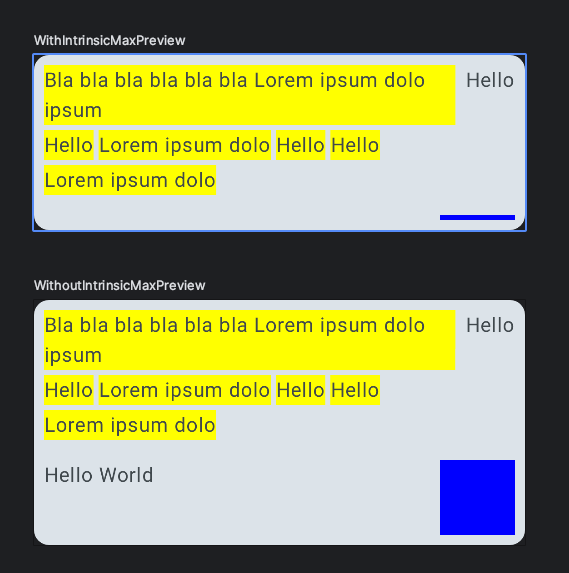

# flowrow-intrinsic-bug

**reproducible issue with flowrow in combination with IntrinsicSize.Max**

## Description

tbd.

## Steps to reproduce

1. Clone the repository

2. Open the project in Android Studio

3. Open de.nilsdruyen.flowrow.intrinsic.FlowRowBug.kt and show preview

## Expected behavior

I would assume that the androidx.compose.foundation.layout.FlowRow is calculating the needed height
correctly and resizes the parent layout so every information its visible

## Issue link

https://issuetracker.google.com/issues/580651951

Related issues:
https://github.com/google/accompanist/issues/622
